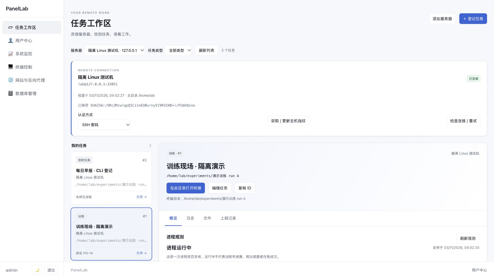

# 远程任务工作台：实现与验证记录

2026-11-03，状态：本轮实现、隔离验收与最终独立复审通过；等待真实使用反馈。基线 `aaaba62`，分支 `feat/remote-workspace`。用户授权自主迭代；此记录不是生产上线批准。

## 为什么改变主线

用户明确表示上一轮 Nginx 可靠变更有收益，却不足以成为主动使用的理由。实际痛点是连接繁琐、记不住命令与路径、终端缺少关联状态；主要任务是模型训练、网站和每日早报等定时任务。本轮把统一任务现场作为主线，原站点能力保留。

具体约束、接口与验收见 [设计](../design/design-remote-workspace.md) 和 [实施计划](../design/plan-remote-workspace.md)。本轮先交付已有任务的登记/观察/文件工作流，人与 Agent 共用 API；是否足以让用户长期使用仍待试用。

## Tailscale：重合与借鉴

Tailscale SSH 管理 tailnet 内的 SSH 认证授权，也允许普通 SSH 在其网络上运行。官方资料进一步显示 Aperture 已支持 Agent 在接入机器上执行命令，以及 MCP 工具代理；不能把 Tailscale 描述成仅有网络连接，也不能把“AI 使用服务器”当成独创点。

- [Tailscale SSH](https://tailscale.com/docs/features/tailscale-ssh)
- [CLI](https://tailscale.com/docs/reference/tailscale-cli)
- [Aperture](https://tailscale.com/docs/aperture/what-is-aperture)
- [MCP server proxying](https://tailscale.com/docs/aperture/mcp-server)

PanelLab 的产品假设是：固定任务对象、日志与结果目录，形成不用聊天或记命令也可操作的现场，并让外部 Agent 使用同样的稳定 ID 与权限。Tailscale 可作为可选网络底座。没有修改实际 tailnet，也没有验证实际 Tailscale SSH/check-mode 或 Aperture 接入。

## 基线与测试环境

- 主仓库 main 与远端 origin/main 均保持原始 `f9df941`；上一轮 `feat/production-reliability` 保留在 `aaaba62`。
- 本轮开始前：后端107 passed（已有1条 Starlette/httpx 弃用提示）；前端23 passed与生产构建通过。
- 自建隔离 Linux SSH/SFTP 镜像使用 Debian bookworm-slim（基镜像摘要 `sha256:99c0b25c46d0214d5a2091092e7908907dcaecd6a962cde0ac700acee222b6f3`）、OpenSSH与Python3；只映射本机随机端口。测试数据库使用自建 MySQL8.4.9 tmpfs实例。
- 模拟训练进程只定期写测试日志；不是实际模型训练，不提供性能或训练质量证据。
- 测试夹具含中文/空格/引号文件名、尾部日志、大文件、符号链接、FIFO，便于检验路径与读取限制。

## 已实现的闭环

- 登录进入任务工作区；保存服务器目标，单独探测并核实公钥后连接。公钥变化拒绝认证，认证方式切换需重新确认，失败可重试。
- 为已有训练、网站、定时任务登记目录、日志和进程。目录/日志通过浏览器点选，进程通过关键词查找并绑定启动身份。
- 概览展示进程现场及服务器资源，日志读尾部，文件可预览和下载；直接在任务或当前浏览目录打开终端。终端确认真实cwd后才显示就绪。
- CLI通过同一API创建、查看和更新任务、读日志/文件、下载和提交上报记录。GUI能直接看到CLI创建的任务。

## 验证与证据

| 层次 | 代码状态与结果 | 证据边界 |
| --- | --- | --- |
| 后端自动化 | `4a4a8ca`：161 passed，38.42s；1条已有Starlette/httpx弃用提示 | 后续至`b724ee0`的代码改动只涉及前端，后端内容相同 |
| 前端自动化 | `b724ee0`：61 passed/6files，生产构建通过 | 不代替浏览器验证 |
| 真实协议集成 | `4a4a8ca`：`python scripts/verify_workspace_lab.py --serve` PASS | 隔离Linux/OpenSSH/SFTP、MySQL、CLI、PTY；无真实云服务器 |
| 浏览器 | 登录默认入口、CLI任务可见；点选中文目录/日志、搜索并绑定进程、保存任务、日志/文件预览、下载、上报标签 | 自建模拟训练夹具；不是模型训练成功证据 |
| 修复后浏览器 | 后端`4a4a8ca`、前端最终`b0a8909`：添加服务器、匹配指纹显式信任、认证切换禁用误用、恢复认证后重试；任务终端运行pwd显示正确目录 | 没有操作真实tailnet |
| 窄屏 | 实测389与391 CSS px，document宽度等于视口宽度；任务切换、文件目录与预览可操作 | 宿主缩放无法得到精确390；不是原生移动端验收 |
| 独立分任务审查 | 连接、任务、UI三个任务规格与质量均通过 | 整分支集中修复后复审亦通过，不代表上线批准 |

真实协议脚本检查：主机公钥核实、未知公钥拒绝、PID身份绑定、中文/空格/引号路径、64KiB日志尾部、目录边界、符号链接/FIFO拒绝、16MiB下载限制、上报来源、服务器删除依赖保护、CLI与API共用对象、真实PTY初始目录、单次票据重放拒绝、主机公钥更换后拒绝并重新核实恢复。

原生浏览器下载的 `result.json` 内容为测试JSON，SHA-256 `aaaa258599d375351585abd5c0f1cab620489dfe2d03d5d440566a4ba584ac3e`。下载留在本机 `/Users/meilingluo/Downloads/result.json`，已不需要，保留未删除。

审查修复包括：初始PTY写入截止时间、隐藏procfs PID不能误判退出、SFTP断线不能误报不存在、真实cwd确认、只接受首帧就绪协议、认证选择与已保存模式一致、保存信任后连接失败仍可重试；同ID改绑时使旧现场、迟到响应、下载与待连接终端失效。针对性测试与差异证据保留在 `.superpowers/sdd/plan-remote-workspace/`。

最后一轮浏览器在`b724ee0`验证CLI改绑同一任务ID：根目录改为outputs并解除PID/日志绑定，刷新列表后界面显示新目录、未绑定进程且没有旧日志；打开终端执行pwd确认进入outputs。普通刷新且绑定不变时保留已浏览的子目录。此轮重新创建隔离环境时脚本再次PASS，完成后已回收。对应[改绑后终端](assets/remote-workspace-rebind.jpg)。

其他浏览器证据：[窄屏文件工作流](assets/remote-workspace-mobile.jpg) · [真实终端pwd](assets/remote-workspace-terminal.jpg)。终端夹具的C locale提示符会转义中文，pwd的实际目录正确；未改动用户shell配置。

## 当前边界与下一步

- 当前是本地Web应用与CLI，尚非双击安装的原生桌面包。目标远程系统要求Linux/Python3；目录终端要求POSIX兼容shell。
- 先观察已有任务；不会启动/停止训练、安装cron、改远程文件或自动执行Agent命令。网站URL仅是打开入口，没有HTTP健康检查。
- 文本/日志64KiB、下载16MiB；不跟随符号链接和特殊文件。大权重传输、上传/断点续传尚未实现。
- 网络只展示累计字节，不是实时速率或按任务流量归因；CPU百分比无区间采样时不可用。无GPU设备的夹具只能验证不可用提示。
- 进程存在不是任务成功，日志变化不是模型进展；上报记录明确标注reported。隐藏/不可见进程保持unknown。
- 普通SSH密码或显式Tailscale SSH模式；没有个人密钥配置、细粒度Agent委派凭证、内置聊天模型或MCP服务器。单次终端票据为单进程内存存储。
- 实际GPU、真实训练、真实tailnet/check-mode、原生打包和生产负载尚未验证。现有站点/数据库能力仍作用于面板配置的共享服务，不能误解成任务所属服务器的远程部署。

下一步应让用户用自己的一个训练或早报任务检验：是否愿意每天从此入口查看、找文件和接续操作。是否足以留住用户尚无证据；若仍需大量手工准备，应优先改接入与任务运行流程，而非继续铺功能。

## 主控决策与可撤销代价

1. 按用户自主迭代授权选择任务工作台方向并实现；方向不合适时需产品返工，不涉及生产变更。
2. 先Web+CLI与已有任务观察，再考虑原生打包和调度；代价是安装与启动任务仍不够一体化。
3. 保留忽略的审查/夹具资料，优先遵循资产保留规则；代价是本地磁盘占用。
4. 增加直接PID查询与有界搜索；代价是少量采集/API复杂度，避免从截断列表推断任务消失。
5. 分别处理僵尸/暂停进程；代价是状态模型更细，避免虚假运行结论。
6. 允许跨任务修正共享SFTP错误分类；代价是共享行为变化，以测试保护断线和路径错误区别。
7. 本轮网络速率为可选，仅实现明确标注的累计计数；代价是实时流量便利性留到后续。
8. 按用户自主Git管理及已有远程仓库的授权，最终审查通过后只推送新功能分支备份；代价是在原私有仓库增加一个可移除分支，main与旧分支不变。

## Git与测试资产

工作在既有隔离worktree的`feat/remote-workspace`分支；主仓库main及远端origin/main未改动，上一轮分支保留。代码分阶段小提交；远端交付目标为原私有仓库的新分支`feat/remote-workspace`，只作备份与审阅，不合并或部署。本机审查资料仍保留；正式复现入口为 `scripts/verify_workspace_lab.py` 与 `scripts/fixtures/remote_workspace/`。

本轮自建API、Vite及浏览器标签已停止/关闭，临时视口已重置。脚本自建SSH/MySQL容器已自动移除；手工SSH夹具容器已停止并保留。没有停止用户既有服务。审查资料、镜像与依赖保留供复核；正式复现不依赖手工夹具。整分支审查在`9dba717`发现一项P2：同ID任务/服务器改绑后需使旧现场失效，已由`b724ee0`一次集中修复，新增16项回归覆盖；最终限定范围复审确认该P2已解决，规格PASS、质量APPROVED，无新增阻断问题。当前CI只监听main/master推送及其PR，单独备份功能分支不会触发CI；不得把本地测试称作远端CI通过。

采集语义参考：[Linux proc stat](https://man7.org/linux/man-pages/man5/proc_pid_stat.5.html) 与 [proc可见性](https://man7.org/linux/man-pages/man5/proc.5.html)。

代码修复最终提交：`b724ee0`；后续提交仅整理验收记录。当前开发分支包含上一轮可靠站点变更的13个提交，再叠加本轮增量，便于整体审阅与后续拆分。远端入口：[feat/remote-workspace](https://github.com/meilingrl/PanelLab/tree/feat/remote-workspace)。
